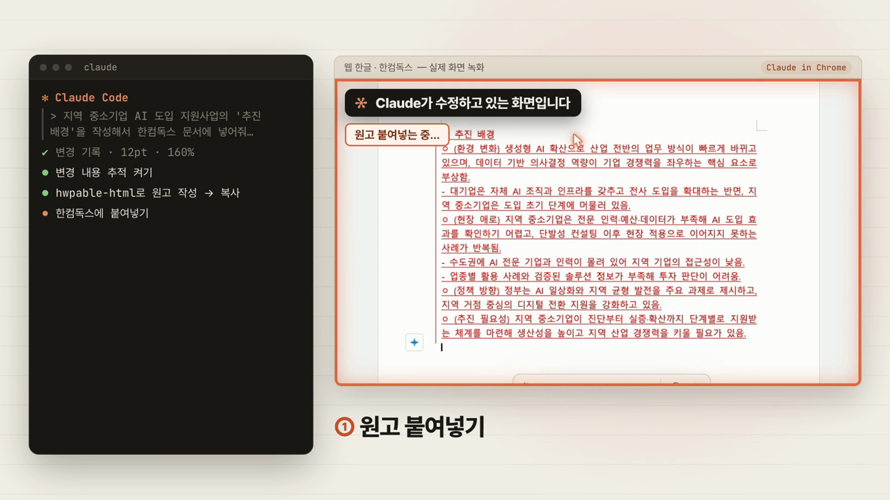
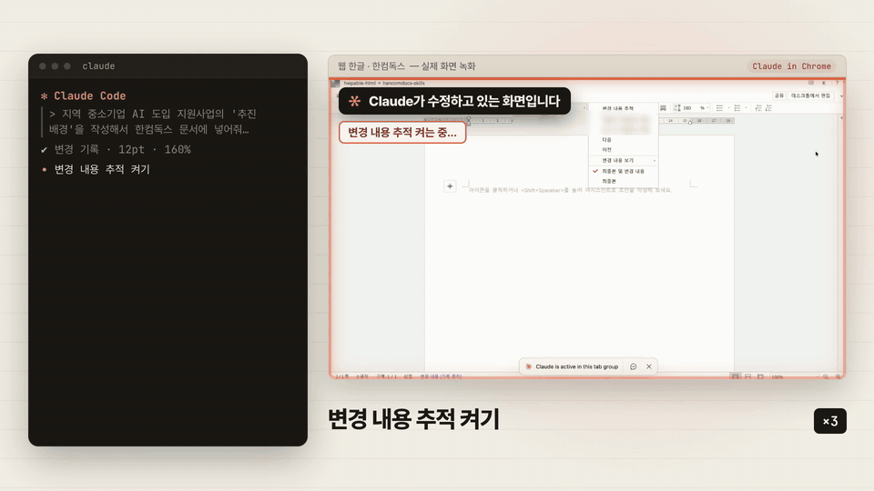
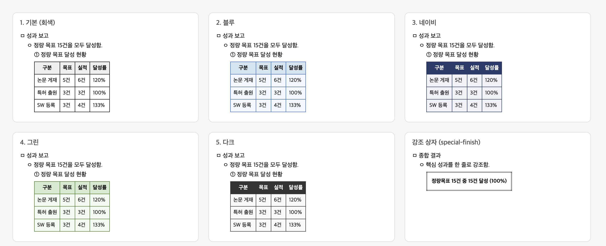
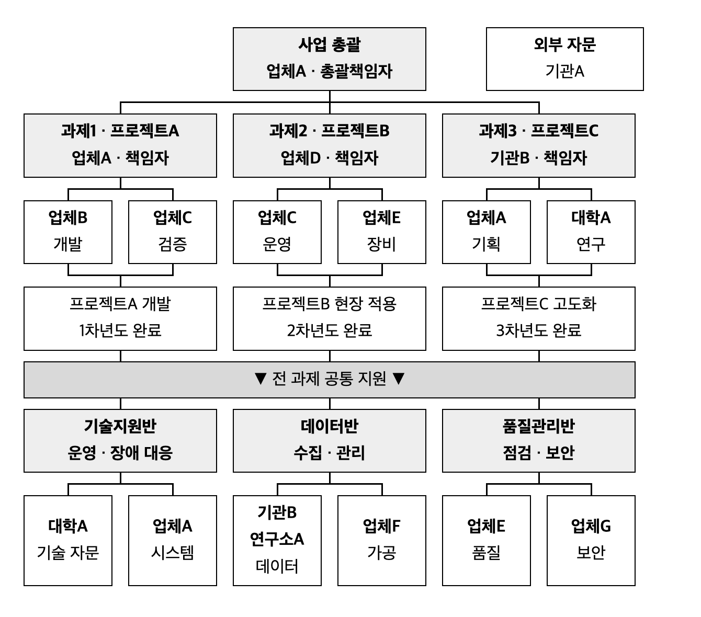

# hancomdocs-skills

한컴독스(hancomdocs.com, 웹 한글)에 올린 `.hwp` 문서를 **Claude가 브라우저로 직접 읽고 고치게** 하는 Claude Code 스킬 묶음입니다.

> Claude Code skills for editing Korean HWP documents on Hancom Docs (web HWP) through Claude in Chrome.

## 소개 영상

터미널에 한 줄 요청하면, Claude가 한컴독스 문서에 원고를 붙여넣고 서식정리·자간까지 끝냅니다. 브라우저 쪽은 실제 화면 녹화입니다(일부 배속).

[](https://github.com/user-attachments/assets/13b23a33-cbed-4c05-82e3-a5b8bfd7d2ed)

## 왜 만들었나

rhwp를 비롯해 HWP를 다루는 스킬과 도구를 정말 많이 써 봤습니다. 파일을 읽거나 새로 만드는 건 잘 됐지만, 정작 실무에는 쓸 수가 없었습니다. 사업계획서나 연구개발계획서는 기관이 내려 준 양식이 있고, 그 양식에 걸린 글자·문단 모양, 표 서식, 쪽 설정을 그대로 지켜야 합니다. 파일을 변환하거나 새로 생성하는 순간 이 세팅이 틀어졌고, 다시 손으로 맞추는 데 시간이 더 들었습니다.

그래서 방향을 바꿨습니다. 양식이 살아 있는 문서를 한컴독스에 올려 두고, **Claude가 브라우저로 그 문서를 직접 만지게** 하는 겁니다.

처음엔 Claude가 쓴 HTML을 그대로 복사해 붙여넣어 봤는데, 서식이 깨져서 들어갔습니다. 그래서 HWP에 붙여넣어도 깨지지 않는 HTML을 만드는 `hwpable-html` 스킬을 먼저 만들었고, 한동안은 그걸로 HTML을 뽑은 뒤 제가 직접 붙여넣었습니다. 지금은 그 과정까지 전부 Claude가 합니다. HTML을 만들고, 한컴독스 문서에 붙여넣고, 표를 '글자처럼 취급'으로 바꾸고, 글머리표 서식과 자간까지 정리합니다.

웹 한글은 본문을 canvas로 그려서 일반적인 브라우저 자동화가 거의 통하지 않습니다. 여기 담긴 내용은 실제 문서로 하나씩 시험해 보면서 **되는 방법과 피해야 할 함정**만 추린 기록입니다. 예를 들면 이런 것들입니다.

- 캔버스에 한글을 직접 치면 글자가 빠진다 → 영문 임시 문자열로 넣고 찾아 바꾸기로 바꾼다
- F5를 누르면 브라우저가 새로 고쳐져 문서가 닫힌다
- 도구 모음의 `한 수준 감소`는 이름과 반대로 한 단계 아래로 내린다


<details>
<summary>GIF로 미리 보기 (12초)</summary>



</details>

## 스킬 구성

한 스킬이 너무 커지지 않도록 역할별로 나눴습니다. 필요한 스킬만 불려 오고, 붙여넣기·서식 스킬은 기본 스킬을 먼저 불러온 뒤 이어서 작업합니다.

| 스킬 | 하는 일 | 이럴 때 |
|---|---|---|
| `hancomdocs-edit` | **기본.** 문서 열기, 클립보드로 본문 읽기, 찾아 바꾸기로 일괄 교체·삭제, 표 줄 추가·삭제, 마무리 검증 | "한컴독스 문서에서 기관명 다 바꿔줘" |
| `hancomdocs-paste` | HTML 붙여넣기로 문단 교체·표 삽입, 표 '글자처럼 취급', 표 줄 간격·폭 | "이 문단 새 버전으로 바꿔 넣어줘" |
| `hancomdocs-format` | 손으로 친 □/◦/- 기호를 진짜 단계 서식으로 정리, 자간으로 줄 넘침 정리 | "글머리표 서식 정리해줘", "한 글자 떨어진 거 맞춰줘" |
| `hwpable-html` | 완성된 글을 HWP에 붙여넣어도 깨지지 않는 HTML로 변환(내용은 그대로, 서식만) | "이 보고서 HWP 붙여넣기용 HTML로" |

```
hwpable-html ──(HTML)──▶ hancomdocs-paste ──▶ hancomdocs-format
                               │                    │
                               └──── hancomdocs-edit (기본) ────┘
```

## hwpable-html: HTML이 HWP에서 깨지는 이유와 해결

Claude가 쓴 HTML을 그대로 HWP에 붙여넣으면 서식이 깨집니다. 무엇이 왜 깨지는지 하나씩 시험해 보고, 깨지지 않는 규칙만 모아 만든 게 `hwpable-html`입니다. **글은 한 글자도 바꾸지 않고 서식만 입힙니다.**

| 그냥 붙여넣으면 | 원인 | hwpable-html의 처리 |
|---|---|---|
| 글자 크기가 제멋대로 | HWP가 `px`·`em`·`rem`을 제대로 옮기지 못함 | 크기는 전부 `pt` (본문 10pt, 표 9pt) |
| 표 머리·캡션이 사라지거나 깨짐 | `<thead>`·`<tbody>`·`<caption>`을 무시함 | `<table>`·`<tr>`·`<th>`·`<td>`만 사용 |
| 표 열 폭이 무너짐 | `<colgroup>`과 CSS 폭을 무시함 | 셀의 `width` 속성으로 폭 고정 |
| 들여쓰기·배치가 흐트러짐 | `flex`·`grid`·`float`를 지원하지 않음 | `<div>` + `margin-left`로 3단계 들여쓰기 |
| 표가 글 흐름 밖으로 튐 | 표가 블록으로 들어감 | `display: inline-table` + `border-collapse: collapse` |
| 그림 크기가 틀어짐 | 크기 속성 없이는 판단하지 못함 | ``에 `width`·`height` 필수 |
| 안내 문구까지 같이 복사됨 | 페이지 전체를 복사함 | 툴바의 **본문 복사**가 `.guide` 안내 문구를 빼고 복사 |

붙여넣은 뒤에도 웹 한글에서 남는 문제가 있습니다. 표가 '글자처럼 취급'이 꺼진 채 들어오고, 표 문단 줄 간격이 고정 값 19.2pt로 들어와 표가 뒤 글과 겹치는 식입니다. 이건 `hancomdocs-paste`가 붙여넣은 다음 자동으로 고칩니다.

### 서식 체계

| 뎁스 | 디폴트형 | 올드형 |
|---|---|---|
| 1 (대항목) | ㅁ | (가), (나), (다)… |
| 2 (중항목) | ㅇ | ①, ②, ③… |
| 3 (소항목) | - | ㉮, ㉯, ㉰… |

### 표 색 프리셋

같은 원고를 프리셋만 바꿔 뽑은 결과입니다. `templates/base.html`의 `th`·`td` 배경과 테두리 색만 바뀌고, 구조와 HWP 호환 규칙은 그대로입니다. 직접 HEX 값을 줘도 됩니다.



| 프리셋 | 머리 칸 배경 | 머리 글자 | 본문 칸 배경 | 테두리 |
|---|---|---|---|---|
| 기본 (회색) | `#EEEEEE` | `#000000` | `#FFFFFF` | `black` |
| 블루 | `#D6E4F0` | `#000000` | `#F5F9FF` | `#4472C4` |
| 네이비 | `#2B3A67` | `#FFFFFF` | `#F0F2F8` | `#2B3A67` |
| 그린 | `#D9E8D0` | `#000000` | `#F5FAF2` | `#548235` |
| 다크 | `#333333` | `#FFFFFF` | `#F9F9F9` | `#333333` |

### 구성도(추진조직표) 모드

사업계획서마다 들어가는 추진체계·컨소시엄 구성도를 **그림이 아니라 표로** 그립니다. 그래서 HWP에 붙여넣은 뒤에도 기관명을 바로 고칠 수 있습니다. 아래는 `scripts/orgchart.py`에 JSON 한 장(`examples/orgchart_example.json`, 기관명은 익명 처리)을 넣어 만든 결과 그대로입니다.



- **상자**: 칸 병합(`colspan`)으로 만듭니다. 상위 단계는 여러 칸을 덮는 넓은 상자, 하위 단계는 좁은 상자입니다.
- **연결선**: 상자 사이 빈 행에서 빈 칸의 위·오른쪽 테두리만 켜서 ┬ 모양을 그립니다.
- **열 폭**: HWP가 `<colgroup>`을 무시하므로, 맨 위 높이 1px짜리 '눈금 행'의 `width` 속성으로 잡습니다.
- **구간 띠**: 과제·공통 지원처럼 성격이 다른 묶음은 회색 띠로 이어 한 표 안에 쌓습니다.

```bash
python3 skills/hwpable-html/scripts/orgchart.py spec.json -o orgchart.html --page
```

## 요구 사항

- [Claude Code](https://claude.com/claude-code)
- [Claude in Chrome](https://claude.com/chrome) 확장 + 한컴독스에 로그인한 크롬
- **현재 검증된 환경은 macOS + Chrome뿐입니다.** 다른 환경은 아래 [기여](#기여)의 할 일 목록을 봐 주세요.

## 설치

**플러그인으로 (권장)**

```
/plugin marketplace add teddysbeach/hancomdocs-skills
/plugin install hancomdocs@hancomdocs-skills
```

**직접 복사**

```bash
git clone https://github.com/teddysbeach/hancomdocs-skills
cp -r hancomdocs-skills/skills/* ~/.claude/skills/
```

## 사용 예

```
한컴독스에 올린 "2026 사업계획서" 열어서 'OO기관'을 'XX기관'으로 다 바꿔줘. 변경 기록은 켜고.
```

```
이 보고서 hwpable-html로 만들고, 한컴독스 문서의 3장 첫 문단을 그걸로 바꿔줘. 서식정리까지.
```

## 주의

- 실전 문서는 **변경 내용 추적을 켜고** 작업하길 권합니다. 스킬도 시작할 때 물어봅니다.
- 표 줄 추가·삭제는 변경 기록에 남지 않습니다. 스킬이 따로 알려 줍니다.
- 다른 사람이 같은 문서를 편집 중이면(오른쪽 위 "편집 (2)") 스킬은 고치지 않고 멈춥니다.
- 본인 계정·본인 문서에 쓰세요. 한컴독스 UI가 바뀌면 일부 절차가 깨질 수 있습니다. 그럴 때 이슈를 남겨 주시면 큰 도움이 됩니다.

## 기여

이 스킬의 핵심은 코드보다 **"이렇게 하니 되더라 / 안 되더라"는 실측 기록**입니다. 한 줄짜리 발견도 환영합니다. 자세한 방법은 [CONTRIBUTING.md](CONTRIBUTING.md)를 봐 주세요.

### 할 일

**플랫폼**

- [x] macOS + Chrome: 찾아 바꾸기로 교체·삭제
- [x] macOS + Chrome: 클립보드로 본문 읽기 (`read_clipboard.sh`)
- [x] macOS + Chrome: 단축키 실측표 (모양 복사 `alt+c`, 자간 `alt+shift+n/w`)
- [x] macOS + Chrome: hwpable-html 붙여넣기, 표 글자처럼 취급
- [ ] Windows: 클립보드 읽기 스크립트 (PowerShell, HTML 형식 포함)
- [ ] Windows: 단축키 실측 (`cmd` → `ctrl` 대응, 자간·모양 복사 키)
- [ ] Windows: hwpable-html 붙여넣기·표 글자처럼 취급 실측
- [ ] Linux: 클립보드 읽기 (`xclip` / `wl-paste`)
- [ ] Edge·Whale 등 다른 크로미움 브라우저 실측
- [ ] 셸 없는 Claude 앱(웹·데스크톱)에서 전체 흐름 실측

**기능**

- [ ] 표 폭을 mm 단위로 정확히 맞추기 (지금은 테두리 드래그로 근사)
- [ ] 변경 내용 추적 수락·거절 자동화
- [ ] 머리말·꼬리말·각주 편집
- [ ] 그림 넣기·바꾸기
- [ ] 글자처럼 취급한 표가 다음 쪽으로 넘어가며 생기는 빈자리 정리
- [ ] 영어 README

## 라이선스

[MIT](LICENSE)
